## First try and how to explore the tool

Let's say we have a vector in `xy` coordinate system `[1,1]` and want to plot it.
We can do it immediately by pasting the following:

```bash
λ echo '[[1,1]]' | zsat draw
```
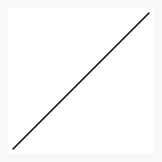

What you should see is a diagonal black line segment spanning whole figure having white-background.
`zsat` interpreted the input as vector, anchored it at (0,0), chose the line color and how it fits the figure, ie. that it fills
almost completely the available space.
As `zsat` aims to be powerful and expressive the aspiring user might request the way to look at those default settings, as well as altering it.
And this is exactly what `--debug` optional argument offers - a peek of what the tool sets exactly during the call.

```bash
λ echo '[[1,1]]' | zsat draw --debug
stdin:
[[1,1]]

--styles e0:{vec2d xy fixed last [lw:10, lc: black, lo: 100, le:none, lj: none, ld: none]}
--datum (vec) -> (vec -> e0)
--outputs (out) -> (anchor {(0,0)}) out
--panes p0:{size: 600x600}
--frames (out) -> out -> p0
```


There are many dimensions to master the tool and it is good to cover each aspect one by one.

## Data shape to be plotted

We piped `[1,1]` to the input. But, why we used double bracket in the end? Because `zsat` handles two types of vector structures that
need to be interpreted separately. And they are worth to be supported and treated differently.
In general, `zsat` differentiates three cases for further processing and presentation:

(a) multi-segment vector is treated as one structure
We already saw what `[[1,1]]` means - vector from (0,0) to (1,1).
`[[1,1], [-1,0]]` represents two-segment vector where `[-1,0]` starts where `[1,1]` ends.
Hence, enclosing the vectors between `[`and `]` means composing the two vectors in such a way
that 2-segment from (0,0) through (1,1) to (0,1) is formed.
Let's see it:

```bash
λ echo '[[1,1],[-1,0]]' | zsat draw
```
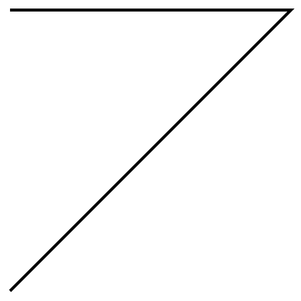

(b) vectors that are gathered together 
If we write on the other hand `[[1,1]], [[-1,0]]` we have two vectors starting from (0,0). The frst one ending at (1,1), the second at (-1,0).
Gathering means all components will share the same style and, if processed, undergo the same transformation.

```bash
λ echo '[[1,1]],[[-1,0]]' | zsat draw
```
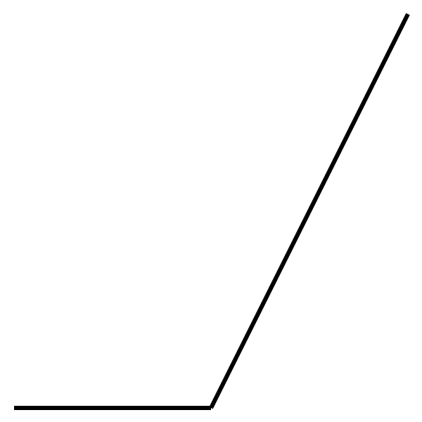

(c) vectors are independent from each other

Each vector structure is interleaved by '\n' character which means each one constitute separate entity, with potentially different style and processing transformation.

```bash
λ echo '[[1,1]]\n[[-1,0]]' | zsat draw
Error: failed to parse input data. Please check your input format.
```

The error stems from the fact that we have two outputs, as each row constitute one output, and we have `--outputs (out) -> (anchor {(0,0)}) out` in the default setting.
In order to handle that correctly we need to specify two outputs, for example, `--outputs (out1, out2) -> ((anchor {(0,0)}) out1, (anchor {(1,1)}) out2)`.
More on this later. Here, we are into understanding how input looks like, and what kind of shapes are supported. 

## Defining styles

The tool provides the default style for the user:

`e0:{vec2d xy fixed last [lw:10, lc: black, lo: 100, le:none, lj: none, ld: none]}`.

Let's decompose what every part means.

`e0` denotes that in other options this particular style is going to be defined by `e0` key.
Once defined in ``styles` option one can reuse the defined element by using `e0`.

What follows, i.e., `{...}`, is the definition body of `e0`, in another words the corresponding value of it.
Here, many things happen and could be influenced.

First of all, `vec2d` is telling how data should be treated - here, we want data in stdin to be treated as 2D vector.
It means we have at the input the data that complies with vector 2d shape, meaning is parsable as specified in the previous section.

`xy` denotes that data values, for example, `[1,2]` should be interpreted in XY coordinate system, and hence `x=1, y=2` there.
We have also polar coordinate system available, which is invoked by writing `polar` rather than `xy`. In that case `[1,30]` would be
interpreted as `r=1, phi=30 degrees`. More on that later.

`fixed` is the setting that is relevant only for n-segment vectors, and here it denotes that each consecutive segment does not depend on its predecessor location and orientation,
and its coordinate pair is expressed with regards to global x and y axis. This setting could be changed to either 'origin' or 'coord' which both redefine coordination system
in which values are defined based on the previous segment, if present. More on this later.

`last` means that we request only last image of the vector to be plotted, which will become relevant when we introduce operations which, if composed between each other, create many intermediary images that end with the final one. 'last' denotes that we want only the final image to be plotted, `all` means the user wants all, i.e.,  intermediary and final, images to be plotted. More on that later.

`[..]` is vector styling setting, `lw` meaning `line width` expressed in pixels, `lc` meaning `line color`, `lo` meaning `line opacity` where 0 is totally transparent, 100 is totally opaque,
`le` meaning `line ending` where besides default 'none' we can choose: `butt`, `round` or `square`. `lj` stands for `line join` and is relevant for n-segment vectors and describes how two segments are attached to each other. With default `none` user has also choices: `mitter`, `round` and `bevel`.
`ld` stands for `line dashing` that is switched off by default, meaning continuous line is to be used. In case one wants to use it, the pattern is specified as `[dash1, off1, dash2, off2,..]` which means the width of the first dash, `dash1`, then empty space, `off1`, and so on. After the pattern, the offset (in pixels) is provided: it tells how far from the start of the dashing pattern we should begin to plot. Everything expressed in pixels. If the overall length of dashes and empty spaces between `[..]` is less than the vector to be covered, after covering the whole length of `[..]` the dashing pattern is continued until the whole length of vector is covered. We will see examples, soon.

Let's start with vector styles and jump immediately to the example.

```bash
λ echo '[[1,1]]' | zsat draw --styles 'e0{[lw:15, lc: aqua]}'
```


We reused `e0` style definition from default and change line width to `15` and line color to `aqua`.
Another example below.

```bash
λ echo '[[1,1]]' | zsat draw --styles 'e0{[lw:15, lc: aqua, lo: 20]}'
```


Now, two examples for dashing to see how it is defined.

```bash
echo '[[1,1]]' | zsat draw --styles 'e0{[lw:15, lc: aqua, ld: [10,10] 0]}'
```


```bash
echo '[[1,1]]' | zsat draw --styles 'e0{[lw:15, lc: aqua, ld: [40,10] 0]}'
```
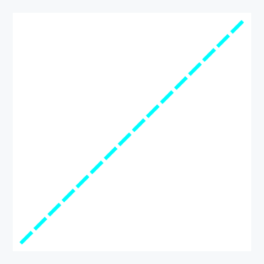

The last value in the dashing definition is the `offset`. It controls from which point of the dashing pattern we want to begin. 

```bash
echo '[[1,1]]' | zsat draw --styles 'e0{[lw:15, lc: aqua, ld: [100,30] 0]}'
```


```bash
echo '[[1,1]]' | zsat draw --styles 'e0{[lw:15, lc: aqua, ld: [100,30] 65]}'
```
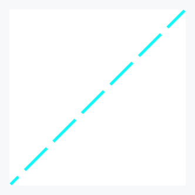

```bash
echo '[[1,1]]' | zsat draw --styles 'e0{[lw:15, lc: aqua, ld: [100,30] 130]}'
```
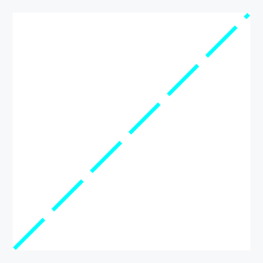

In the first figure we start with `0` offset meaning we start from the beggining of the pattern. In the middle figure we start exactly in the middle of the pattern
as the pattern is `100+30=130` pixels. Then in the third figure we wrap up, and start from the pattern's beginning. This means that specifying `ld: [100,30] 0` and
`ld: [100,30] 130` is equivalent.

## Multiple datum

As we mentioned in the section about data, objects that are to be treated differently need to be delivered in separate lines.

```bash
λ printf '[[1,1]]\n[[0,1]]' | ./zig-out/bin/zsat draw \
> --styles 'e1: e0{[lw:15, lc: aqua]}, e2: e0{[lw:5, lc: red]}' \
> --datum '(vec1, vec2) -> (vec1 -> e1, vec2 -> e2)' \
> --outputs '(out1, out2) -> ((anchor {(0,0)}) out1, (anchor {(0,0)}) out2)'
```
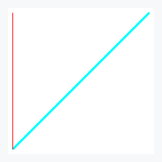

By separating vectors with `\n` we decided that they are to be treated as separate data entities. We also defined two styles: `s1` and `s2` both basing on default style `e0` and setting only the fields we want to overwrite with new values. We could also use `e1` to define `e2`, 'e1: e0{[lw:15, lc: aqua]}, e2: e1{[ld: [30,30] 5]}'. Here, we would have `e2` having line width `15`, `aqua` color and being dashed in constrast to `e1` that would be continuous.
So we defined two styles, now in `--datum` we are supposed to map those styles to data objects. `(vec1, vec2)` are handles (one could name them as they want) for data objects as they are delivered in stdin. Using tuple also conveys order so `vec1` is the handle for `[[1,1]]` and `vec2` for `[[0,1]]`.  `vec1 -> e1` means data object captured by `vec1` will have `e1` style attached to it.
You do not have to use all styles: it is perfectly ok to define 5 styles but nly use one. Hence, using `--datum '(vec1, vec2) -> (vec1 -> e1, vec2 -> e1)'` or even `--datum '(vec1, vec2) -> (vec1 -> e0, vec2 -> e0)'` (if we added also `e0` or `e0: e0` in styles, otherwise `e0` is not exposed for later use) is perfectly fine, though superfluous.
Finally, we need to relate the object to the space of the panes. Vectors are abstract entities and in order to relate them to concrete space we need to pin them there. This is done via usage of `anchor POINT`. Let's see other capabilities of **POINT** in examples.

```bash
λ printf '[[1,1]]\n[[0,0.5],[0.5,0]]' | ./zig-out/bin/zsat draw \
> -s 'e1: e0{[lw:15, lc: aqua]}, e2: e0{[lw:5, lc: red]}' \
> -d '(vec1, vec2) -> (vec1 -> e1, vec2 -> e2)' \
> -o '(out1, out2) -> ((anchor {(0,0)}) out1, (anchor {(0.5,0.5)}) out2)'
```
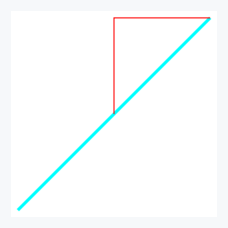

```bash
λ printf '[[1,1]]\n[[0,0.5],[0.5,0]]' | ./zig-out/bin/zsat draw \
> -s 'e1: e0{[lw:15, lc: aqua]}, e2: e0{[lw:5, lc: red]}' \
> -d '(vec1, vec2) -> (vec1 -> e1, vec2 -> e2)' \
> -o '(out1, out2) -> ((anchor {(0,0)}) out1, (anchor (middle out1)) out2)'
```


```bash
λ printf '[[1,1]]\n[[0,0.5],[0.5,0]]' | ./zig-out/bin/zsat draw \
> -s 'e1: e0{[lw:15, lc: aqua]}, e2: e0{[lw:5, lc: red]}' \
> -d '(vec1, vec2) -> (vec1 -> e1, vec2 -> e2)' \
> -o '(out1, out2) -> ((anchor {(0,0)}) out1, (anchor (25% out1)) out2)'
```
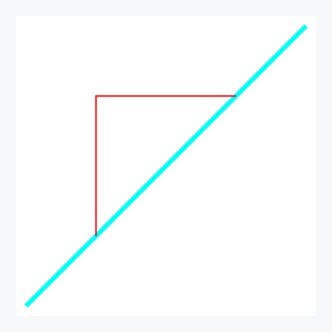

```bash
λ printf '[[1,1]]\n[[0,0.5],[0.5,0]]' | ./zig-out/bin/zsat draw \
> -s 'e1: e0{[lw:15, lc: aqua]}, e2: e0{[lw:5, lc: red]}' \
> -d '(vec1, vec2) -> (vec1 -> e1, vec2 -> e2)' \
> -o '(out1, out2) -> ((anchor {(0,0)}) out1, (anchor (-25% out1)) out2)'
```
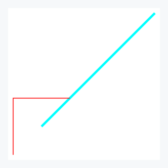

```bash
λ printf '[[1,1]]\n[[0,0.5],[0.5,0]]' | ./zig-out/bin/zsat draw \
> -s 'e1: e0{[lw:15, lc: aqua]}, e2: e0{[lw:5, lc: red]}' \
> -d '(vec1, vec2) -> (vec1 -> e1, vec2 -> e2)' \
> -o '(out1, out2) -> ((anchor {(0,0)}) out1, (anchor (125% out1)) out2)'
```
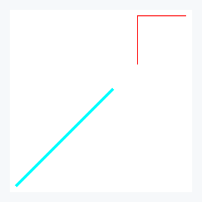

We can have substitute point explicite, `{(x,y)}`, but also implicite by refering it to some object, and here we can use `beg`, `mid`, `end` or `NUM%` which will establish point counting from the beginning of the object where whole lenght is 100%.
