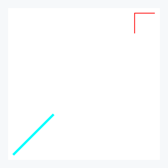
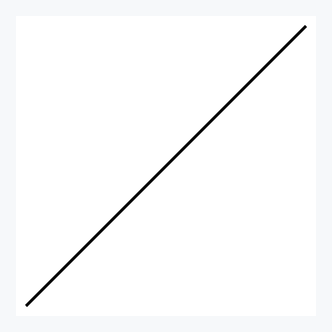
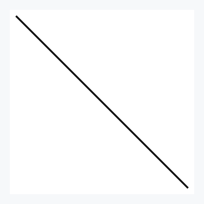
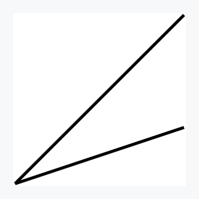
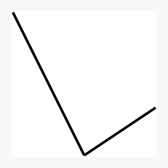
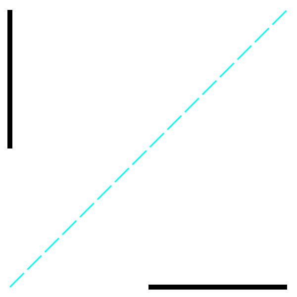
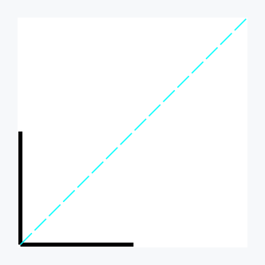

## First try and how to explore the tool

Let's say we have a vector in the `xy` coordinate system, `[1,1]`, and want to plot it.
We can do it immediately by pasting the following:

```bash
echo '[[1,1]]' | zsat draw
```


What you should see is a diagonal black line segment spanning the whole figure with a white background.
`zsat` interpreted the input as a vector, anchored it at (0,0), chose the line color, and determined how it fits the figure — i.e., so that it almost completely fills the available space.
As `zsat` aims to be powerful and expressive, the aspiring user might want a way to inspect those default settings, as well as alter them.
And this is exactly what the `--debug` optional argument offers — a peek at what the tool sets exactly during the call.

```bash
echo '[[1,1]]' | zsat draw --debug
stdin:
[[1,1]]

--styles e0:{vec2d xy fixed last [lw:10, lc: black, lo: 100, le:none, lj: none, ld: none]}
--datum (vec) -> (vec -> e0)
--outputs (out) -> (anchor {(0,0)}) out
--panes p0:{size: 600x600}
--frames (out) -> out -> p0
```


There are many dimensions to master in the tool, and it is good to cover each aspect one by one.

## Data shape to be plotted

We piped `[1,1]` to the input. But why did we use double brackets in the end? Because `zsat` handles two types of vector structures that need to be interpreted separately, and they are worth supporting and treating differently.
In general, `zsat` differentiates three cases for further processing and presentation:

(a) multi-segment vector is treated as one structure
We already saw what `[[1,1]]` means — a vector from (0,0) to (1,1).
`[[1,1], [-1,0]]` represents a two-segment vector where `[-1,0]` starts where `[1,1]` ends.
Hence, enclosing the vectors between `[` and `]` means composing the two vectors in such a way
that a 2-segment from (0,0) through (1,1) to (0,1) is formed.
Let's see it:

```bash
echo '[[1,1],[-1,0]]' | zsat draw
```


(b) vectors that are gathered together 
If we write, on the other hand, `[[1,1]], [[-1,0]]` we have two vectors starting from (0,0). The first one ending at (1,1), the second at (-1,0).
Gathering means all components will share the same style and, if processed, undergo the same transformation.

```bash
echo '[[1,1]],[[-1,0]]' | zsat draw
```


(c) vectors are independent from each other

Each vector structure is separated by a '\n' character, which means each one constitutes a separate entity, with potentially different style and processing transformation.

```bash
echo '[[1,1]]\n[[-1,0]]' | zsat draw
Error: failed to parse input data. Please check your input format.
```

The error stems from the fact that we have two outputs, as each row constitutes one output, and we have `--outputs (out) -> (anchor {(0,0)}) out` in the default setting.
In order to handle that correctly we need to specify two outputs, for example, `--outputs (out1, out2) -> ((anchor {(0,0)}) out1, (anchor {(1,1)}) out2)`.
More on this later. Here, we are into understanding how input looks like, and what kind of shapes are supported. 

## Defining styles

The tool provides the default style for the user:

`e0:{vec2d xy fixed last [lw:10, lc: black, lo: 100, le:none, lj: none, ld: none]}`.

Let's decompose what every part means.

`e0` denotes that in other options this particular style is going to be defined by the `e0` key.
Once defined in the `styles` option, one can reuse the defined element by using `e0`.

What follows, i.e., `{...}`, is the definition body of `e0` — in other words, the corresponding value of it.
Here, many things happen and can be influenced.

First of all, `vec2d` indicates how data should be treated — here, we want data in stdin to be treated as a 2D vector.
It means the input data complies with the vector 2d shape, meaning it is parsable as specified in the previous section.

`xy` denotes that data values, for example, `[1,2]` should be interpreted in the XY coordinate system, and hence `x=1, y=2` there.
We also have a polar coordinate system available, which is invoked by writing `polar` rather than `xy`. In that case `[1,30]` would be
interpreted as `r=1, phi=30 degrees`. More on that later.

`fixed` is the setting that is relevant only for n-segment vectors, and here it denotes that each consecutive segment does not depend on its predecessor's location and orientation,
and its coordinate pair is expressed with regard to the global x and y axes. This setting can be changed to either 'origin' or 'coord', which both redefine the coordinate system
in which values are defined based on the previous segment, if present. More on this later.

`last` means that we request only the last image of the vector to be plotted, which will become relevant when we introduce operations that, if composed with each other, create many intermediary images ending with the final one. 'last' denotes that we want only the final image to be plotted; `all` means the user wants all, i.e., intermediary and final, images to be plotted. More on that later.

`[..]` is the vector styling setting: `lw` means `line width` expressed in pixels, `lc` means `line color`, `lo` means `line opacity` where 0 is totally transparent and 100 is totally opaque,
`le` means `line ending`, where besides the default 'none' we can choose `butt`, `round`, or `square`. `lj` stands for `line join` and is relevant for n-segment vectors; it describes how two segments are attached to each other. With the default `none`, the user also has choices: `mitter`, `round`, and `bevel`.
`ld` stands for `line dashing` that is switched off by default, meaning a continuous line is to be used. If one wants to use it, the pattern is specified as `[dash1, off1, dash2, off2, ..]`, which means the width of the first dash, `dash1`, then empty space, `off1`, and so on. After the pattern, the offset (in pixels) is provided: it tells how far from the start of the dashing pattern we should begin to plot. Everything is expressed in pixels. If the overall length of dashes and empty spaces within `[..]` is less than the vector to be covered, after covering the whole length of `[..]` the dashing pattern is continued until the whole length of the vector is covered. We will see examples soon.

Let's start with vector styles and jump immediately to the example.

```bash
echo '[[1,1]]' | zsat draw \
--styles 'e0{[lw:15, lc: aqua]}'
```


We reused the `e0` style definition from default and changed the line width to `15` and the line color to `aqua`.
Another example below.

```bash
echo '[[1,1]]' | zsat draw \
--styles 'e0{[lw:15, lc: aqua, lo: 20]}'
```


Now, two examples for dashing to see how it is defined.

```bash
echo '[[1,1]]' | zsat draw \
--styles 'e0{[lw:15, lc: aqua, ld: [10,10] 0]}'
```


```bash
echo '[[1,1]]' | zsat draw \
--styles 'e0{[lw:15, lc: aqua, ld: [40,10] 0]}'
```


The last value in the dashing definition is the `offset`. It controls from which point of the dashing pattern we want to begin. 

```bash
echo '[[1,1]]' | zsat draw --styles \
'e0{[lw:15, lc: aqua, ld: [100,30] 0]}'
```


```bash
echo '[[1,1]]' | zsat draw \
--styles 'e0{[lw:15, lc: aqua, ld: [100,30] 65]}'
```


```bash
echo '[[1,1]]' | zsat draw \
--styles 'e0{[lw:15, lc: aqua, ld: [100,30] 130]}'
```


In the first figure we start with `0` offset, meaning we start from the beginning of the pattern. In the middle figure we start exactly in the middle of the pattern
as the pattern is `100+30=130` pixels. Then in the third figure we wrap up and start from the pattern's beginning. This means that specifying `ld: [100,30] 0` and
`ld: [100,30] 130` is equivalent.

## Multiple datum

As we mentioned in the section about data, objects that are to be treated differently need to be delivered in separate lines.

```bash
printf '[[1,1]]\n[[0,1]]' | zsat draw \
--styles 'e1: e0{[lw:15, lc: aqua]}, e2: e0{[lw:5, lc: red]}' \
--datum '(vec1, vec2) -> (vec1 -> e1, vec2 -> e2)' \
--outputs '(out1, out2) -> ((anchor {(0,0)}) out1, (anchor {(0,0)}) out2)'
```


By separating vectors with `\n`, we decided that they are to be treated as separate data entities. We also defined two styles: `s1` and `s2`, both based on the default style `e0`, setting only the fields we want to overwrite with new values. We could also use `e1` to define `e2`: `e1: e0{[lw:15, lc: aqua]}, e2: e1{[ld: [30,30] 5]}`. Here, `e2` would have line width `15`, `aqua` color, and be dashed in contrast to `e1`, which would be continuous.
So we defined two styles; now in `--datum` we are supposed to map those styles to data objects. `(vec1, vec2)` are handles (one could name them as they want) for data objects as they are delivered in stdin. Using a tuple also conveys order, so `vec1` is the handle for `[[1,1]]` and `vec2` for `[[0,1]]`. `vec1 -> e1` means the data object captured by `vec1` will have the `e1` style attached to it.
You do not have to use all styles: it is perfectly okay to define 5 styles but only use one. Hence, using `--datum '(vec1, vec2) -> (vec1 -> e1, vec2 -> e1)'` or even `--datum '(vec1, vec2) -> (vec1 -> e0, vec2 -> e0)'` (if we also added `e0` or `e0: e0` in styles; otherwise `e0` is not exposed for later use) is perfectly fine, though superfluous.
Finally, we need to relate each object to the space of the panes. Vectors are abstract entities, and in order to relate them to concrete space we need to pin them there. This is done via usage of `anchor POINT`. Let's see other capabilities of **POINT** in examples.

```bash
printf '[[1,1]]\n[[0,0.5],[0.5,0]]' | zsat draw \
-s 'e1: e0{[lw:15, lc: aqua]}, e2: e0{[lw:5, lc: red]}' \
-d '(vec1, vec2) -> (vec1 -> e1, vec2 -> e2)' \
-o '(out1, out2) -> ((anchor {(0,0)}) out1, (anchor {(0.5,0.5)}) out2)'
```


```bash
printf '[[1,1]]\n[[0,0.5],[0.5,0]]' | zsat draw \
-s 'e1: e0{[lw:15, lc: aqua]}, e2: e0{[lw:5, lc: red]}' \
-d '(vec1, vec2) -> (vec1 -> e1, vec2 -> e2)' \
-o '(out1, out2) -> ((anchor {(0,0)}) out1, (anchor (middle out1)) out2)'
```


```bash
printf '[[1,1]]\n[[0,0.5],[0.5,0]]' | zsat draw \
-s 'e1: e0{[lw:15, lc: aqua]}, e2: e0{[lw:5, lc: red]}' \
-d '(vec1, vec2) -> (vec1 -> e1, vec2 -> e2)' \
-o '(out1, out2) -> ((anchor {(0,0)}) out1, (anchor (25% out1)) out2)'
```


```bash
printf '[[1,1]]\n[[0,0.5],[0.5,0]]' | zsat draw \
-s 'e1: e0{[lw:15, lc: aqua]}, e2: e0{[lw:5, lc: red]}' \
-d '(vec1, vec2) -> (vec1 -> e1, vec2 -> e2)' \
-o '(out1, out2) -> ((anchor {(0,0)}) out1, (anchor (-25% out1)) out2)'
```


```bash
printf '[[1,1]]\n[[0,0.5],[0.5,0]]' | zsat draw \
-s 'e1: e0{[lw:15, lc: aqua]}, e2: e0{[lw:5, lc: red]}' \
-d '(vec1, vec2) -> (vec1 -> e1, vec2 -> e2)' \
-o '(out1, out2) -> ((anchor {(0,0)}) out1, (anchor (125% out1)) out2)'
```


We can specify a point explicitly, `{(x,y)}`, or implicitly by referring it to some object, and here we can use `beg`, `mid`, `end`, or `NUM%`, which will establish a point counting from the beginning of the object where the whole length is 100%.
See below for the proof — we have moved the anchor of the red segments even further away, and the framing adjusted.

```bash
printf '[[1,1]]\n[[0,0.5],[0.5,0]]' | zsat draw \
-s 'e1: e0{[lw:15, lc: aqua]}, e2: e0{[lw:5, lc: red]}' \
-d '(vec1, vec2) -> (vec1 -> e1, vec2 -> e2)' \
-o '(out1, out2) -> ((anchor {(0,0)}) out1, (anchor (300% out1)) out2)'
```


## Datum transformation with straightforward composing

Now let's focus on what can be done with data after raw ingestion from stdin. As we see above, we deal with vectors, and because of that we always need to pin them in space (through the `anchor` operation).
We do this as part of `--output`, where we first take all the handles of the data in the tuple `(out1, ...)` and then use each handle. When it comes to vectors, anchoring is mandatory and the minimal operation that must be present. We can have other operation(s) performed on top of pinning, like rotation, scaling, or mirroring, which can be composed using `&`.
Composing here means just plain successive application (think `.` in Haskell or `&` (aka `ampv`) in J). So `(op2 & op1) out` is equivalent to `op2 (op1 out)`.
Let's look at the available transformations now. For the sake of simplicity, we start with a vector from {(0,0)} to {(1,1)} along with the `-debug` option to reveal all default options used. 

```bash
printf '[[1,1]]' | zsat draw --debug \
-o '(out) -> (anchor {(0,0)}) out' 
stdin:
[[1,1]]

--styles e0:{vec2d xy fixed last [lw:10, lc: black, lo: 100, le:none, lj: none, ld: none]}
--datum (vec) -> (vec -> e0)
--outputs (out) -> (anchor {(0,0)}) out
--panes p0:{size: 600x600}
--frames (out) -> out -> p0
```


Now, let's transform the input vector by rotating it around its beginning by 90 degrees counter-clockwise.

```bash
printf '[[1,1]]' | zsat draw --debug \
-o '(out) -> ((rotate [90 a (0% self)]) & (anchor {(0,0)})) out' 
stdin:
[[1,1]]

--styles e0:{vec2d xy fixed last [lw:10, lc: black, lo: 100, le:none, lj: none, ld: none]}
--datum (vec) -> (vec -> e0)
--outputs (out) -> ((rotate [90 a (0% self)]) & (anchor {(0,0)})) out
--panes p0:{size: 600x600}
--frames (out) -> out -> p0
```


As we see, thanks to the `--debug` option, `last` is used inside the definition of the `e0` style. It instructs to plot only the final result of the transformation.
But we might be interested in the intermediary images at all steps of the transformation. Please notice that if we have three operations combined using `&`, as below

```bash
(out) -> (op3 & op2 & op1) out
```

then we will have the following three intermediary results

```bash
(op1) out
(op2 & op1) out
(op3 & op2 & op1) out
```

See the examples building on top of the one above:

```bash
printf '[[1,1]]' | zsat draw --debug \
-s 'e0:{vec2d all}' \
-o '(out) -> ((rotate [90 a (0% self)]) & (anchor {(0,0)})) out'
stdin:
[[1,1]]

--styles e0:{vec2d all}
--datum (vec) -> (vec -> e0)
--outputs (out) -> ((rotate [90 a (0% self)]) & (anchor {(0,0)})) out
--panes p0:{size: 600x600}
--frames (out) -> out -> p0
```


```bash
printf '[[1,1]]' | zsat draw --debug \
-s 'e0:{vec2d all}' \
-o '(out) -> ((r [-90 a (mid self)]) & (rotate [90 a (0% self)]) & (anchor {(0,0)})) out'
stdin:
[[1,1]]

--styles e0:{vec2d all}
--datum (vec) -> (vec -> e0)
--outputs (out) -> ((r [-90 a (mid self)]) & (rotate [90 a (0% self)]) & (anchor {(0,0)})) out
--panes p0:{size: 600x600}
--frames (out) -> out -> p0
```


**Note on point definition**

Point definition is used inside the `rotate` transformation. One can realize it explicitly, for example, with `{(1,2)}`, or by referring to other objects.
Here, one can use `self` when referring to itself or other refs. To be well-defined, we also need to specify which part of the referenced object we want to point to.
Hence, `beg`, `mid`, and `end`. If this is not enough one can use percentage instead. `0%` would be equivalent to the beginning, and `100%` to the end.
It is worth mentioning one can also use negative values.

**Note on angles**

Angle definitions can be expressed either in degrees or radians. In the former case, we formulate the angle in degrees. In the latter, in radians, which we specify using `p`.
For example, `180` degrees is equivalent to `p`, `45` degrees to `1r4p`. Here, `r` is used for ratio — appreciate the advantage of using `1r3p` instead of `0.3333p`.

Now, let's use the `scale` transformation, abbreviated by `s`, which scales both components according to the argument specified.

```bash
printf '[[1,1]]' | zsat draw \
-s 'e0:{vec2d all}' \
-o '(out) -> ((s [[1,3]]) & (a {(0,0)})) out'
```


```bash
printf '[[1,1]]' | zsat draw \
-s 'e0:{vec2d all}' \
-o '(out) -> ((s [[-1,3]]) & (a {(0,0)})) out'
```


As we see, a negative value in `scale` makes the resultant component direction opposite. Values less than 1 perform shrinking, while values greater than 1 enforce elongation.

The `mirror` transformation, abbreviated by `m`, requires a line argument in the form of `ay=bx+c` against which the vector is to be reflected.
Let's try the `[1,1]` vector mirrored against first `x=0.5` and then `y=1` lines.

```bash
printf '[[1,1]]' | zsat draw \
-s 'e0:{vec2d all}' \
-o '(out) -> (m (x=0.5) & a {(0,0)}) out'
```


```bash
printf '[[1,1]]' | zsat draw \
-s 'e0:{vec2d all}' \
-o '(out) -> (m (y=1) & m (x=0.5) & a {(0,0)}) out'
```


TODO (**orto** and **project**)

**Note on coordinate systems**

Until now we used, implicitely as it is a default setting, **fixed** coordination system. It basically means upon application of transformations we want to work with the global coordinate system.
So  `{(0,0)}` is constant coordinate origin and axis stay still. If one uses **origin** we are still demanding the same orientation of the axis, but the origin is __MOVED__ to the end of the vector of the last step (in case this is the first step we start from `{(0,0)}`).

```bash
printf '[[1,0]]\n[[2,2]]' | zsat draw \
-s 'e0:{vec2d all}, e1:{[lw:5, lc: aqua, ld: [40,10] 0]}' \
-d '(vec0, vec1) -> (vec0 -> e0, vec1 -> e1)' \
-o '(out0, out1) -> ((m (y=x) & a {(1,0)}) out0, (a {(0,0)}) out1)'
```


Dashed line is here used to illustrate where mirror line `y=x` is located for a chosen coordinate system.


```bash
printf '[[1,0]]\n[[2,2]]' | zsat draw \
-s 'e0:{vec2d all origin}, e1:{[lw:5, lc: aqua, ld: [40,10] 0]}' \
-d '(vec0, vec1) -> (vec0 -> e0, vec1 -> e1)' \
-o '(out0, out1) -> ((m (y=x) & a {(1,0)}) out0, (a {(1,0)}) out1)'
```


In `origin` (but also 'coord' mode in this context) after the first transformation the origin of the coordinate system moves to point (1,0), so `y=x` is constructed there.
This means the vector being the result of mirror is adjacent to the vector after first step.   