# First **zsat** tutorial

**Table of Contents**
- [First try and how to explore the tool](#first-try-and-how-to-explore-the-tool)
- [Data shape to be plotted](#data-shape-to-be-plotted)
- [Defining styles](#defining-styles)
- [Multiple data](#multiple-data)
- [Datum transformation with straightforward composing](#datum-transformation-with-straightforward-composing)
- [Adding text](#adding-text)
- [Adding axis](#adding-axis)
- [Exploring the tool through help](#exploring-the-tool-through-help)

## First try and how to explore the tool

Let's say we have a vector in the `xy` coordinate system, `[1,1]`, and want to plot it.
We can do it immediately by running:

```bash
echo '[[1,1]]' | zsat draw
```


What you should see is a diagonal black line segment against a white background.
`zsat` interpreted the input as a vector, anchored it at `(0,0)`, chose the line color, and determined how it fits the figure — i.e., so that it almost completely fills the available space.
As `zsat` aims to be powerful and expressive, users might want a way to inspect these default settings and alter them.
This is exactly what the `--debug` optional argument offers — a peek at the exact settings used during the call.

```bash
echo '[[1,1]]' | zsat draw --debug
stdin:
[[1,1]]

--styles e0:{vec2d xy fixed last [l:10, c: black, o: 100, e:none, j: none, d:none]}}
--datum (vec) -> (vec -> e0)
--outputs (out) -> (anchor {(0,0)}) out
--panes p0:{size: 600x600, border: none}
--frames (out) -> out -> p0
```


There are many dimensions to master in the tool, and it is best to cover each aspect one by one.

**Pane borders**

By default, panes have no border. You can add one inline inside a pane definition:

```bash
echo '[[1,1]]' | zsat draw -p 'p0:{size: 300x300, border: [w:20, c:red]}'
```

Or define a reusable border in `--styles` and reference it by name:

```bash
echo '[[1,1]]' | zsat draw -s 'b0: {border [w:20, c:red]}' -p 'p0:{size: 300x300, border: b0}'
```

The border width reduces the available drawing area: a 300-wide pane with a 20-pixel border leaves 260 pixels for the plot content. Border attributes support both full names and abbreviations:
- `width` / `w` — thickness in pixels
- `opacity` / `o` — opacity from 0 to 100
- `color` / `c` — any CSS color name

## Data shape to be plotted

We piped `[1,1]` to the input. But why the double brackets?
Because `zsat` handles two types of vector structures that need to be interpreted separately, and they are worth supporting and treating differently.
In general, `zsat` differentiates three cases for further processing and presentation:

**(a) Multi-segment vector**

A multi-segment vector is treated as one structure.
We already saw what `[[1,1]]` means — a vector from `(0,0)` to `(1,1)`.
`[[1,1], [-1,0]]` represents a two-segment vector where `[-1,0]` starts where `[1,1]` ends.
Hence, enclosing the vectors between `[` and `]` means composing them so that
a 2-segment vector from `(0,0)` through `(1,1)` to `(0,1)` is formed.
Let's see it:

```bash
echo '[[1,1],[-1,0]]' | zsat draw
```


**(b) Gathered vectors**

If we write `[[1,1]], [[-1,0]]`, on the other hand, we have two vectors starting from `(0,0)`.
The first ends at `(1,1)`, the second at `(-1,0)`.
Gathering means all components will share the same style and, if processed, undergo the same transformation.

```bash
echo '[[1,1]],[[-1,0]]' | zsat draw
```


**(c) Independent vectors**

Each vector structure is separated by a newline character (`\n`), meaning each one constitutes a separate entity that can have a different style and undergo different processing.

```bash
printf '[[1,1]]\n[[-1,0]]' | zsat draw
Error: failed to parse input data. Please check your input format.
```

The error occurs because we now have two outputs (one per row), but the default `--outputs` setting only defines a single output.
To handle this correctly, we need to specify two outputs — for exampe:
`--outputs '(out1, out2) -> ((anchor {(0,0)}) out1, (anchor {(1,1)}) out2)'`.
More on this later. For now, we are focusing on understanding what input shapes are supported.

## Defining styles

The tool provides a default stye:

`e0:{vec2d xy fixed last [l:10, c: black, o: 100, e:none, j: none, d: none]}`.

Let's break down what each part means.

`e0` denotes that in other options this particular style is going to be defined by the `e0` key.
Once defined in the `styles` option, one can reuse the defined element by using `e0`.

What follows — `{...}` — is the definition body, i.e., the value associated with `e0`.
Here, many things happen and can be influenced.

First, `vec2d` indicates how data should be treated.
Here, stdin data is interpreted as 2D vectors.
This means the input data conforms to the 2D vector shape described in the previous section.

`xy` denotes that data values — for example, `[1,2]` — should be interpreted in the XY coordinate system, and hence `x=1, y=2` there.
We also have a polar coordinate system available, which is invoked by writing `polar` rather than `xy`.
In that case `[1,30]` would be interpreted as `r=1, phi=30` degrees. More on that later.

`fixed` is the setting relevant only for n-segment vectors.
Here it denotes that each consecutive segment does not depend on its predecessor's location or orientation,
and its coordinate pair is expressed with regard to the global x and y axes.
This setting can be changed to either `origin` or `coord`, which both redefine the coordinate system
in which values are defined based on the previous segment, if present. More on that later.

`last` means that only the final image of the vector is plotted, which will become relevant when we introduce operations that, if composed with each other, create many intermediary images ending with the final one.
`last` denotes that we want only the final image to be plotted; `all` means the user wants all images — i.e., intermediary and final — to be plotted. More on that later.

`[..]` is the vector styling setting:
- `l` means **line width**, expressed in pixels
- `c` means **line color**
- `o` means **line opacity**, where `0` is totally transparent and `100` is totally opaque
- `e` means **line ending**; besides the default `none`, the choices are `butt`, `round`, or `square`
- `j` stands for **line join** and is relevant for n-segment vectors; it describes how two segments are attached to each other. In addition to the default `none`, the choices are `miter`, `round`, and `bevel`
- `d` stands for **line dashing**, which is switched off by default, meaning a continuous line is used. If one wants to use it, the pattern is specified as `[dash1, off1, dash2, off2, ..]`, which means the width of the first dash, `dash1`, then empty space, `off1`, and so on. After the pattern, the offset (in pixels) is provided: it tells how far from the start of the dashing pattern we should begin to plot. Everything is expressed in pixels. If the overall length of dashes and empty spaces within `[..]` is less than the vector to be covered, after covering the whole length of `[..]` the dashing pattern is continued until the whole length of the vector is covered. We will see examples soon.

Let's see some examples of vector styling.

```bash
echo '[[1,1]]' | zsat draw \
--styles 'e0{[l:15, c: aqua]}'
```


We reused the default `e0` style and changed the line width to `15` and the line color to `aqua`.
Another example below.

```bash
echo '[[1,1]]' | zsat draw \
--styles 'e0{[l:15, c: aqua, o: 20]}'
```


Now, two examples showing how dashing is defined.

```bash
echo '[[1,1]]' | zsat draw \
--styles 'e0{[l:15, c: aqua, d: [10,10] 0]}'
```


```bash
echo '[[1,1]]' | zsat draw \
--styles 'e0{[l:15, c: aqua, d: [40,10] 0]}'
```


The last value in the dashing definition is the `offset`. It controls where in the dashing pattern we start.

```bash
echo '[[1,1]]' | zsat draw --styles \
'e0{[l:15, c: aqua, d: [100,30] 0]}'
```


```bash
echo '[[1,1]]' | zsat draw \
--styles 'e0{[l:15, c: aqua, d: [100,30] 65]}'
```


```bash
echo '[[1,1]]' | zsat draw \
--styles 'e0{[l:15, c: aqua, d: [100,30] 130]}'
```


In the first figure we start with `0` offset, meaning we start from the beginning of the pattern.
In the middle figure we start exactly in the middle of the pattern, as the pattern is `100+30=130` pixels long.
In the third figure we wrap around and start from the pattern's beginning again.
This means that specifying `d: [100,30] 0` and `d: [100,30] 130` is equivalent.

## Multiple data

As mentioned in the data section, objects that require different treatment must be provided on separate lines.

```bash
printf '[[1,1]]\n[[0,1]]' | zsat draw \
--styles 'e1: e0{[l:15, c: aqua]}, e2: e0{[l:5, c: red]}' \
--datum '(vec1, vec2) -> (vec1 -> e1, vec2 -> e2)' \
--outputs '(out1, out2) -> ((anchor {(0,0)}) out1, (anchor {(0,0)}) out2)'
```


By separating vectors with `\n`, we indicate that they should be treated as separate data entities.
We also defined two styles: `e1` and `e2`, both based on the default style `e0`, setting only the fields we want to overwrite with new values.
We could also use `e1` to define `e2`: `e1: e0{[l:15, c: aqua]}, e2: e1{[d: [30,30] 5]}`.
Here, `e2` would have line width `15`, `aqua` color, and be dashed, in contrast to `e1`, which would be continuous.
So we defined two styles; now in `--datum` we map those styles to data objects.
`(vec1, vec2)` are handles (one could name them as they want) for data objects as they are delivered in stdin.
Using a tuple also conveys order, so `vec1` is the handle for `[[1,1]]` and `vec2` for `[[0,1]]`.
`vec1 -> e1` means the data object captured by `vec1` will have the `e1` style attached to it.
You do not have to use all defined styles — it is perfectly fine to define five but use only one.
Hence, using `--datum '(vec1, vec2) -> (vec1 -> e1, vec2 -> e1)'` or even `--datum '(vec1, vec2) -> (vec1 -> e0, vec2 -> e0)'` (if we also added `e0` or `e0: e0` in styles; otherwise `e0` is not exposed for later use) is perfectly fine, though superfluous.
Finally, we need to place each object in the pane space.
Vectors are abstract entities; to place them in concrete space we need to pin them there using `anchor POINT`.
Let's see other capabilities of **POINT** in examples.

```bash
printf '[[1,1]]\n[[0,0.5],[0.5,0]]' | zsat draw \
-s 'e1: e0{[l:15, c: aqua]}, e2: e0{[l:5, c: red]}' \
-d '(vec1, vec2) -> (vec1 -> e1, vec2 -> e2)' \
-o '(out1, out2) -> ((anchor {(0,0)}) out1, (anchor {(0.5,0.5)}) out2)'
```


```bash
printf '[[1,1]]\n[[0,0.5],[0.5,0]]' | zsat draw \
-s 'e1: e0{[l:15, c: aqua]}, e2: e0{[l:5, c: red]}' \
-d '(vec1, vec2) -> (vec1 -> e1, vec2 -> e2)' \
-o '(out1, out2) -> ((anchor {(0,0)}) out1, (anchor (middle out1)) out2)'
```


```bash
printf '[[1,1]]\n[[0,0.5],[0.5,0]]' | zsat draw \
-s 'e1: e0{[l:15, c: aqua]}, e2: e0{[l:5, c: red]}' \
-d '(vec1, vec2) -> (vec1 -> e1, vec2 -> e2)' \
-o '(out1, out2) -> ((anchor {(0,0)}) out1, (anchor (25% out1)) out2)'
```


```bash
printf '[[1,1]]\n[[0,0.5],[0.5,0]]' | zsat draw \
-s 'e1: e0{[l:15, c: aqua]}, e2: e0{[l:5, c: red]}' \
-d '(vec1, vec2) -> (vec1 -> e1, vec2 -> e2)' \
-o '(out1, out2) -> ((anchor {(0,0)}) out1, (anchor (-25% out1)) out2)'
```


```bash
printf '[[1,1]]\n[[0,0.5],[0.5,0]]' | zsat draw \
-s 'e1: e0{[l:15, c: aqua]}, e2: e0{[l:5, c: red]}' \
-d '(vec1, vec2) -> (vec1 -> e1, vec2 -> e2)' \
-o '(out1, out2) -> ((anchor {(0,0)}) out1, (anchor (125% out1)) out2)'
```


A point can be specified explicitly as `{(x,y)}`, or implicitly by referring to another object using `beg`, `mid`, `end`, or `NUM%`.
The percentage counts from the beginning of the object, where the full length equals 100%.
As shown below, we have moved the anchor of the red segments even further, and the framing has adjusted.

```bash
printf '[[1,1]]\n[[0,0.5],[0.5,0]]' | zsat draw \
-s 'e1: e0{[l:15, c: aqua]}, e2: e0{[l:5, c: red]}' \
-d '(vec1, vec2) -> (vec1 -> e1, vec2 -> e2)' \
-o '(out1, out2) -> ((anchor {(0,0)}) out1, (anchor (300% out1)) out2)'
```


## Datum transformation with straightforward composing

Now let's focus on what can be done with data after it is read from stdin.
As we see above, we deal with vectors, and because of that we al ays need to pin them in space (through the `anchor` operation).
We do this in `--output`, where we first declare all data handles in a tuple `(out1, ...)` and then apply operations to each.
For vectors, anchoring is mandatory — it is the minimal required operation.
Additional operations such as rotation, scaling, or mirroring can be composed on top of anchoring using `&`.
Composition here means plain successive application (think `.` in Haskell or `&` in J).
Thus, `(op2 & op1) out` is equivalent to `op2 (op1 out)`.
For simplicity, we start with a vector from `(0,0)` to `(1,1)` and use the `--debug` option to reveal the default settings.

```bash
printf '[[1,1]]' | zsat draw --debug \
-o '(out) -> (anchor {(0,0)}) out'
stdin:
[[1,1]]

--styles e0:{vec2d xy fixed last [l:10, c: black, o: 100, e:none, j: none, d:none]}}
--datum (vec) -> (vec -> e0)
--outputs (out) -> (anchor {(0,0)}) out
--panes p0:{size: 600x600, border: none}
--frames (out) -> out -> p0
```


Now let's rotate the input vector 90 degrees counter-clockwise around its beginning.

```bash
printf '[[1,1]]' | zsat draw --debug \
-o '(out) -> ((rotate [90 a (0% self)]) & (anchor {(0,0)})) out'
stdin:
[[1,1]]

--styles e0:{vec2d xy fixed last [l:10, c: black, o: 100, e:none, j: none, d:none]}}
--datum (vec) -> (vec -> e0)
--outputs (out) -> ((rotate [90 a (0% self)]) & (anchor {(0,0)})) out
--panes p0:{size: 600x600, border: none}
--frames (out) -> out -> p0
```


As we can see from the `--debug` output, `last` is used in the `e0` style definition, instructing the tool to plot only the final result of the transformation.
But we might also want to see the intermediate images at each step.
Note that if we combine three operations using `&`, as shown below:

```bash
(out) -> (op3 & op2 & op1) out
```

then we will have the following three intermediate resuls:

```bash
(op1) out
(op2 & op1) out
(op3 & op2 & op1) out
```

Here are examples building on the one above:

```bash
printf '[[1,1]]' | zsat draw --debug \
-s 'e0:{vec2d all}' \
-o '(out) -> ((rotate [90 a (0% self)]) & (anchor {(0,0)})) out'
stdin:
[[1,1]]

--styles e0:{vec2d xy fixed all [l:10, c: black, o: 100, e:none, j: none, d:none]}}
--datum (vec) -> (vec -> e0)
--outputs (out) -> ((rotate [90 a (0% self)]) & (anchor {(0,0)})) out
--panes p0:{size: 600x600, border: none}
--frames (out) -> out -> p0
```


```bash
printf '[[1,1]]' | zsat draw --debug \
-s 'e0:{vec2d all}' \
-o '(out) -> ((r [-90 a (mid self)]) & (rotate [90 a (0% self)]) & (anchor {(0,0)})) out'
stdin:
[[1,1]]

--styles e0:{vec2d xy fixed all [l:10, c: black, o: 100, e:none, j: none, d:none]}}
--datum (vec) -> (vec -> e0)
--outputs (out) -> ((r [-90 a (mid self)]) & (rotate [90 a (0% self)]) & (anchor {(0,0)})) out
--panes p0:{size: 600x600, border: none}
--frames (out) -> out -> p0
```


**Note on point definition**

Point definitions are used inside transformations like `rotate`.
They can be specified explicitly, e.g., `{(1,2)}`, or by referring to other objects.
Use `self` to refer to the current object, or name other objects directly.
To be well-defined, we must also specify which part of the referenced object to point o:
hence `beg`, `mid`, and `end`.
If that is not enough, percentages can be used instead.
`0%` is equivalent to the beginning, and `100%` to the end.
It is worth mentioning that one can also use negative values.

**Note on angles**

Angles can be expressed either in degrees or radians.
In the former case, angles are given in degrees. In the latter, they are given in radians using `p`.
For example, `180` degrees is equivalent to `p`, and `45` degrees to `1r4p`.
Here, `r` stands for ratio — notice the advantage of using `1r3p` instead of `0.3333p`.

Now let's use the `scale` transformation (abbreviated `s`), which scales both components according to the given argument.

```bash
printf '[[1,1]]' | zsat draw \
-s 'e0:{vec2d all}' \
-o '(out) -> ((s [[1,3]]) & (a {(0,0)})) out'
```


```bash
printf '[[1,1]]' | zsat draw \
-s 'e0:{vec2d all}' \
-o '(out) -> ((s [[-1,3]]) & (a {(0,0)})) out'
```


As we can see, a negative value in `scale` reverses the direction of the corresponding component.
Values less than 1 shrink the component, while values greater than 1 elongate it.

**Mirror transformation**

The `mirror` transformation (abbreviated `m`) requires a line argument in the form `ay=bx+c` against which the vector is reflected.
Let's mirror the `[1,1]` vector first against `x=0.5` and then against `y=1`.

```bash
printf '[[1,1]]' | zsat draw \
-s 'e0:{vec2d all}' \
-o '(out) -> (m (x=0.5) & a {(0,0)}) out'
```


```bash
printf '[[1,1]]' | zsat draw \
-s 'e0:{vec2d all}' \
-o '(out) -> (m (y=1) & m (x=0.5) & a {(0,0)}) out'
```


Now, projection and orthogonal transformations. The target for these operations can be one of three things:

1. **A line** — the vector is projected onto (or decomposed orthogonally to) that line in space.
2. **Another output** — the vector is decomposed relative to the other output's direction. The projection is drawn on the other output's line; the orthogonal starts where the projection ends. Their vector sum equals the original.
3. **A point** — produces a unit vector anchored at that point. `p POINT` gives a unit vector parallel to the current output; `o POINT` gives a unit vector 90° counter-clockwise from it.

First, projection onto a line (shadow projection):

```bash
printf '[[1,1]]\n[[0,2]],[[2,0]]' | zsat draw  \
-s 'e0:{all [l:20]}, e1:{[l:5, c: aqua, d: [40,10] 0]}' \
-d '(vec0, vec1) -> (vec0 -> e0, vec1 -> e1)'  \
-o '(out0, out1) -> ((p (y=0) & a {(1,1)}) out0, (a {(0,0)}) out1)'
```
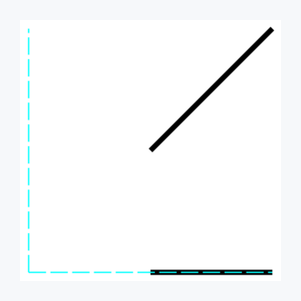

```bash
printf '[[1,1]]\n[[0,2]],[[2,0]]' | zsat draw  \
-s 'e0:{all [l:20]}, e1:{[l:5, c: aqua, d: [40,10] 0]}' \
-d '(vec0, vec1) -> (vec0 -> e0, vec1 -> e1)'  \
-o '(out0, out1) -> ((p (x=0) & a {(1,1)}) out0, (a {(0,0)}) out1)'
```
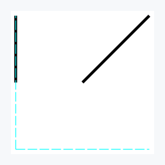

```bash
printf '[[1,1]]\n[[0,2]],[[2,0]]' | zsat draw  \
-s 'e0:{all [l:20]}, e1:{[l:5, c: aqua, d: [40,10] 0]}' \
-d '(vec0, vec1) -> (vec0 -> e0, vec1 -> e1)'  \
-o '(out0, out1) -> ((p (y=0.3*x) & a {(1,1)}) out0, (a {(0,0)}) out1)'
```
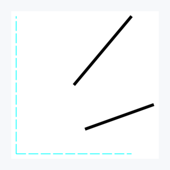

Unit vectors anchored at a point — parallel (`p`) and orthogonal (`o`) to the current output:

```bash
printf '[[1,1]]\n[[0,2]],[[2,0]]' | zsat draw  \
-s 'e0:{all [l:20]}, e1:{[l:5, c: aqua, d: [40,10] 0]}' \
-d '(vec0, vec1) -> (vec0 -> e0, vec1 -> e1)'  \
-o '(out0, out1) -> ((p {(1,0.8)} & a {(1,1)}) out0, (a {(0,0)}) out1)'
```
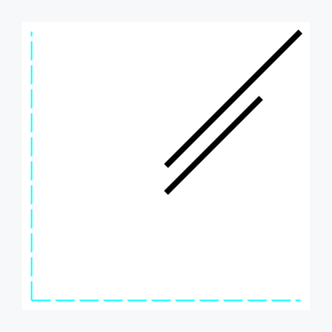

```bash
printf '[[1,1]]\n[[0,2]],[[2,0]]' | zsat draw  \
-s 'e0:{all [l:20]}, e1:{[l:5, c: aqua, d: [40,10] 0]}' \
-d '(vec0, vec1) -> (vec0 -> e0, vec1 -> e1)'  \
-o '(out0, out1) -> ((o {(1,0.8)} & a {(1,1)}) out0, (a {(0,0)}) out1)'
```
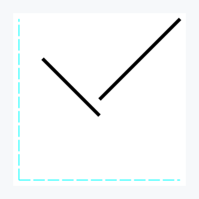

Decomposition relative to another output. Projection plus orthogonal equals the original vector:

```bash
printf '[[1,1]]\n[[0,2]],[[2,0]]\n[[2,0.5]]' | zsat draw \
-s 'e0:{all [l:20]}, e1:{[l:5, c: aqua, d: [40,10] 0]}, e2: {[l:30, c: grey, o: 50]}' \
-d '(vec0, vec1, vec2) -> (vec0 -> e0, vec1 -> e1, vec2 -> e2)' \
-o '(out0, out1, out2) -> ((o out2 & a {(1,1)}) out0, (a {(0,0)}) out1, (a {(0.5,0.5)}) out2)'
```
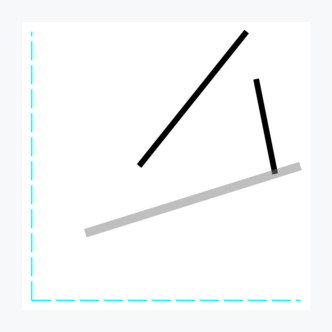

```bash
printf '[[1,1]]\n[[0,2]],[[2,0]]\n[[2,0.5]]' | zsat draw \
-s 'e0:{all [l:20]}, e1:{[l:5, c: aqua, d: [40,10] 0]}, e2: {[l:30, c: grey, o: 50]}' \
-d '(vec0, vec1, vec2) -> (vec0 -> e0, vec1 -> e1, vec2 -> e2)' \
-o '(out0, out1, out2) -> ((p out2 & a {(1,1)}) out0, (a {(0,0)}) out1, (a {(0.5,0.5)}) out2)'
```
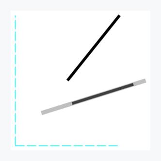

Points can also be specified by reference to another output. Here `p (m out2)` produces a unit vector parallel to out0, anchored at the midpoint of out2:

```bash
printf '[[1,1]]\n[[0,2]],[[2,0]]\n[[2,0.5]]' | zsat draw \
-s 'e0:{all [l:20]}, e1:{[l:5, c: aqua, d: [40,10] 0]}, e2: {[l:30, c: grey, o: 50]}' \
-d '(vec0, vec1, vec2) -> (vec0 -> e0, vec1 -> e1, vec2 -> e2)' \
-o '(out0, out1, out2) -> ((p (m out2) & a {(1,1)}) out0, (a {(0,0)}) out1, (a {(0.5,0.5)}) out2)'
```
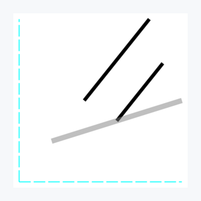


**Note on coordinate systems**

Until now we have implicitly used the **fixed** coordinate system, as it is the default.
So `(0,0)` is a fixed coordinate origin and the axes do not move.
If **origin** is used, the axes keep the same orientation, but the origin is moved to the end of the vector from the last step (for the first step, we start from `(0,0)`).

```bash
printf '[[1,0]]\n[[2,2]]' | zsat draw \
-s 'e0:{vec2d all}, e1:{[l:5, c: aqua, d: [40,10] 0]}' \
-d '(vec0, vec1) -> (vec0 -> e0, vec1 -> e1)' \
-o '(out0, out1) -> ((m (y=x) & a {(1,0)}) out0, (a {(0,0)}) out1)'
```


The dashed line illustrates where the mirror line `y=x` is located for the chosen coordinate system.

```bash
printf '[[1,0]]\n[[2,2]]' | zsat draw \
-s 'e0:{vec2d all origin}, e1:{[l:5, c: aqua, d: [40,10] 0]}' \
-d '(vec0, vec1) -> (vec0 -> e0, vec1 -> e1)' \
-o '(out0, out1) -> ((m (y=x) & a {(1,0)}) out0, (a {(1,0)}) out1)'
```


In `origin` mode (and `coord` mode in this context), after the first transformation the origin moves to `(1,0)`, so `y=x` is constructed there.
This means the mirrored vector is adjacent to the vector from the first step.
`coord` mode also moves the coordinate origin, as `origin` does, but additionally reorients the axes so that the x-axis aligns with the last step's vector direction.
Let's look at an example and discuss it to illustrate this mode.

```bash
printf '[[1,1]]\n[[2,2]]' | zsat draw \
-s 'e0:{vec2d all coord}, e1:{[l:5, c: aqua, d: [40,10] 0]}' \
-d '(vec0, vec1) -> (vec0 -> e0, vec1 -> e1)' \
-o '(out0, out1) -> ((a {(1,0)}) out0, (a {(0,0)}) out1)'
```
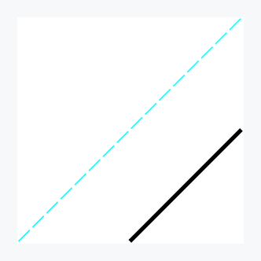

In the second transformation, if `coord` is active, the vector from the first transformation becomes the direction of the x-axis for the next coordinate system.
The new coordinate system is also shifted to global `(1,0)`.
Here, `y=x` is the vertical line passing through the origin, against which the mirror operates.

```bash
printf '[[1,1]]\n[[0,2]]' | zsat draw \
  -s 'e0:{vec2d all coord}, e1:{[l:5, c: aqua, d: [40,10] 0]}' \
  -d '(vec0, vec1) -> (vec0 -> e0, vec1 -> e1)' \
  -o '(out0, out1) -> ((m (y=x) & a {(1,0)}) out0, (a {(1,0)}) out1)'
```
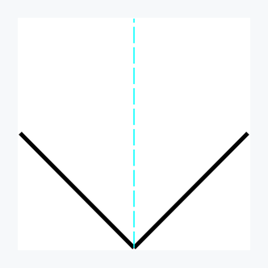

**Note on coordinate types**

Until now we have used the default `xy` coordinate type, which represents the Euclidean coordinate system.
One can also use the `polar` type, where we use `(r, phi)` to determine position.
`phi` is the angle argument we already covered before.

```bash
printf '[[1,45]]' | zsat draw \
  -s 'e0:{vec2d polar all coord}' \
  -o '(out) -> (r [45 a (end self)] & a {(0,0)}) out'
```

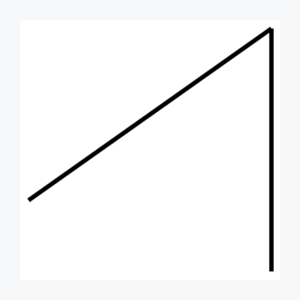

The stdin input sets `(r, phi) = (1, 45°)`, and the next step rotates 45 degrees counter-clockwise around the end of the first step's result.

```bash
printf '[[1,45]]' | zsat draw \
  -s 'e0:{vec2d polar all}' \
  -o '(out) -> (r [-1r6p a (beg self)] & r [45 a (end self)] & a {(0,0)}) out'
```
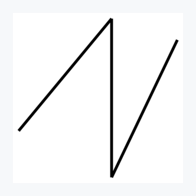

**Multi-segment data**

We have seen how separate data is delivered (via newline-separated stdin) and handled independently.
If we want data to be treated as a single object where segments relate to one another, multi-segment vectors are the way to go.

```bash
printf '[[1,45], [1,10], [2,30]]' | zsat draw \
  -s 'e0:{vec2d polar all}' \
  -o '(out) -> (a {(0,0)}) out'
```


The 3-segment vector is constructed so that the second segment starts where the first ends, and the third starts where the second ends.
The structure behaves as a whoe: it adopts the style and undergoes transformations together.
See the example below.

```bash
printf '[[1,45], [1,10], [2,30]]\n[[3.5,3.5]]' | zsat draw \
  -s 'e0:{vec2d polar all}, e1:{[l:5, c: aqua, d: [40,10] 0]}' \
  -d '(vec0, vec1) -> (vec0 -> e0, vec1 -> e1)' \
  -o '(out0, out1) -> ((m (y=x) & a {(0,0)}) out0, (a {(0,0)}) out1)'
```
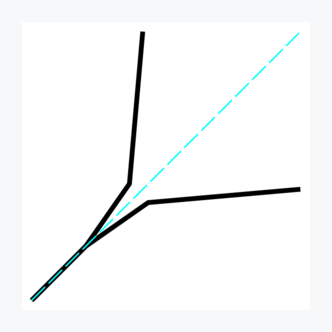

## Adding text

Besides vectors, `zsat` can overlay text on the plot. Text is defined in `--styles` and then anchored in `--outputs`.

**Defining text**

Text definitions use the `txt` (or `t`) keyword:

```bash
echo '[[1,1]]' | zsat draw --debug \
  -s 'e0:{vec2d}, t0: {txt "hello" [c:red, s:20]}' \
  -o '(out) -> ((a {(0,0)}) out, (a {(0.5,0.5)}) t0)'
stdin:
[[1,1]]

--styles e0:{vec2d xy fixed last [l:10, c: black, o: 100, e:none, j: none, d:none]}}, t0: {txt "hello" [c:red, s:20, f:default, o:100]}
--datum (vec) -> (vec -> e0)
--outputs (out) -> ((a {(0,0)}) out, (a {(0.5,0.5)}) t0)
--panes p0:{size: 600x600, border: none}
--frames (out) -> out -> p0
```
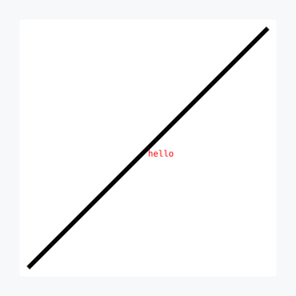

Text attributes inside `[...]` support both full names and abbreviations:
- `color` / `c` — any CSS color name
- `size` / `s` — font size in pixels
- `font` / `f` — font name
- `opacity` / `o` — opacity from 0 to 100

Unspecified attributes inherit from defaults (`c: black`, `s: 16`, `f: default`, `o: 100`). This inheritance property implies a minimal definition to be `t0: {txt "hello"}`.

**Positioning and rotating text**

Like for a vector a text must be anchored in `--outputs` to appear in the pane. This can be done explicitely via 'a' or by operation that assumes pinning.
The defined text below undergoes rotating operation via `r` around the point `(0.5, 0.5)`.

```bash
echo '[[1,1]]' | zsat draw --debug \
  -s 'e0:{vec2d}, t0: {txt "hello" [c:red, s:20]}' \
  -o '(out) -> ((a {(0,0)}) out, (r [45 a {(0.5,0.5)}]) t0)'
stdin:
[[1,1]]

--styles e0:{vec2d xy fixed last [l:10, c: black, o: 100, e:none, j: none, d:none]}}, t0: {txt "hello" [c:red, s:20, f:default, o:100]}
--datum (vec) -> (vec -> e0)
--outputs (out) -> ((a {(0,0)}) out, (r [45 a {(0.5,0.5)}]) t0)
--panes p0:{size: 600x600, border: none}
--frames (out) -> out -> p0
```
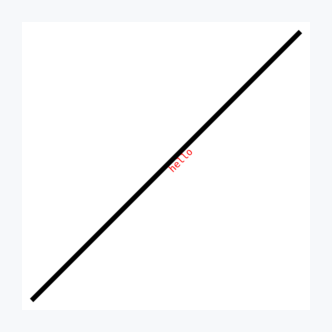

Here the text is anchored at the point `(0.5,0.5)` and rotated 45 degrees counter-clockwise around itself.
Meaning it is the same as if we compose two operations together:

```bash
echo '[[1,1]]' | ./zig-out/bin/zsat draw \
  -s 'e0:{vec2d}, t0: {txt "hello" [c:red, s:20]}' \
  -o '(out) -> ((a {(0,0)}) out, (r [45 a (self)] & a {(0.5,0.5)}) t0)'
```

Please notice that when rotation is done against not itself then the rotation is done to the whole text with internal orientation intact.
Rotation around itself results in internal rotation. This behaviour is by design and is found intuitive by the author. 

In general, one should not expect for the composition to be commutative. Indeed, rotation followed by anchoring gives another result that the its flipped composition. 

```bash
echo '[[1,1]]' | zsat draw --debug \
  -s 'e0:{vec2d}, t0: {txt "hello" [c:red, s:30]}' \
  -o '(out) -> ((a {(0,0)}) out, (r [45 a {(0.5,0.5)}] & a {(0.8,0.8)}) t0)'
stdin:
[[1,1]]

--styles e0:{vec2d xy fixed last [l:10, c: black, o: 100, e:none, j: none, d:none]}}, t0: {txt "hello" [c:red, s:20, f:default, o:100]}
--datum (vec) -> (vec -> e0)
--outputs (out) -> ((a {(0,0)}) out, (r [45 a {(0.5,0.5)}] & a {(0.8,0.8)}) t0)
--panes p0:{size: 600x600, border: none}
--frames (out) -> out -> p0
```
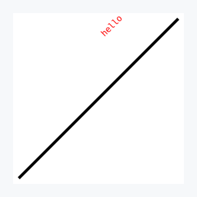

```bash
echo '[[1,1]]' | zsat draw \
  -s 'e0:{vec2d}, t0: {txt "hello" [c:red, s:30]}' \
  -o '(out) -> ((a {(0,0)}) out, (a {(0.8,0.8)} & r [45 a {(0.5,0.5)}]) t0)'
```
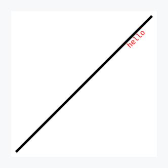


Text can also override its default or previously defined value inline in `--outputs` without redefining the style, just by referencing:

```bash
echo '[[1,1]]' | zsat draw --debug \
  -s 'e0:{vec2d}, t0: {txt "hello" [c:red, s:20]}' \
  -o '(out) -> ((a {(0,0)}) out, (a {(0.5,0.5)}) t0{"world"})'
stdin:
[[1,1]]

--styles e0:{vec2d xy fixed last [l:10, c: black, o: 100, e:none, j: none, d:none]}}, t0: {txt "hello" [c:red, s:20, f:default, o:100]}
--datum (vec) -> (vec -> e0)
--outputs (out) -> ((a {(0,0)}) out, (a {(0.5,0.5)}) t0{"world"})
--panes p0:{size: 600x600, border: none}
--frames (out) -> out -> p0
```


## Adding axis

In one of the previous examples we used additional `aqua` dashed lines as axes. See, below

```bash
printf '[[1,1]]\n[[0,2.5]],[[2.5,0]]\n[[2,0.5]]' | zsat draw \
  -s 'e0:{all [l:20]}, e1:{[l:5, c: aqua, d: [40,10] 0]}, e2: {[l:30, c: grey, o: 50]}' \
  -d '(vec0, vec1, vec2) -> (vec0 -> e0, vec1 -> e1, vec2 -> e2)' \
  -o '(out0, out1, out2) -> ((p out2 & a {(1,1)}) out0, (a {(0,0)}) out1, (a {(0.5,0.5)}) out2)' \
  -p 'p0:{size: 600x600, border: [w:25, c:lightgrey]}'
```
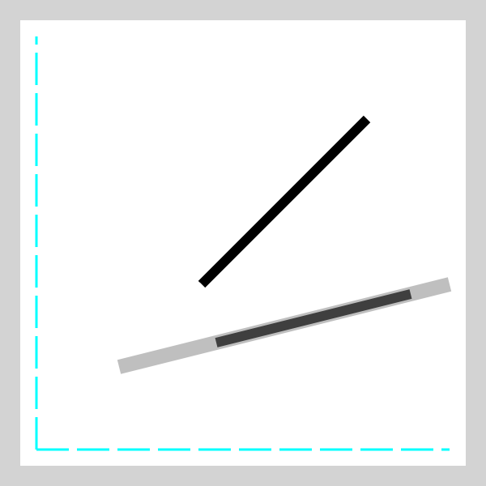

Naturally, it is highly unsatisfactory to have **axis** like that, we might use this way as some additional line though.
We have `axis` object that we can refine in terms of styling (in `--style`) that is designed to help here. Let's jump immediately into an example and comment what happened afterwards.

```bash
printf '[[1,1]]\n[[2,0.5]]' | zsat draw \
  -s 'e0:{all [l:20]}, e1: {[l:30, c: grey, o: 50]}, \
  a0: {axis line:[c:grey, o:80, s:5], ticks:[pos:0,0.5,..,3, style:[c:lightgrey, o:80, s:5, h:12, f:above]],values:[vals:0,1,2,3, style:[c:black, o:80, s:25, sp:4, f:above]]}' \
  -d '(vec0, vec1) -> (vec0 -> e0, vec1 -> e1)' \
  -o '(out0, out1) -> ((p out2 & a {(1,1)}) out0, (a {(0.5,0.5)}) out2, ft {(0,0)} {(3.2,0)} a1)' \
  -p 'p0:{size: 600x600, border: [w:25, c:lightgrey]}'
```
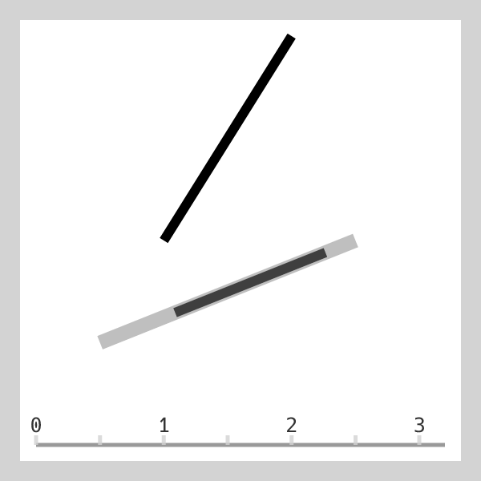

So we have `a0` axis object defined where one can define separately how axis line and what/how ticks look like. And also independetnly what tick values to present and how to present them.
`line` attribute should not be surprise as it follows pattern already learned for vectors. in `ticks` size one `size` aka `s` determine requested tick line width and `height` aka `h` tick line height. Caller can also choose if the tick is presented above or below line, the angle with regards to the tick line (counter clockwise movement represented by positive values) plus the most important what ticks to display. Here, we requested to display every tick from 0 and 3  with step 0.5. One can also be explicit and enumerate exactly which step to plot. Here, the mirror substitute would be just `0, 0.5, 1, 1.5, 2, 2.5, 3` so we chose the shortcut version above.
With regards to values, the pattern is very similar both with style and values. When defined, `a0` axis object is available in later steps, where we can anchor it in the plot by using `fromTo` aka `ft` in outputs. Here we are just providing two points, start and finish ones.

Now when `a0` is defined, we can reuse it with only selected attribute value rewrites. Thanks to that the style characteristic stays the same as in the case of the horizontal axis.

```bash
printf '[[1,1]]\n[[2,0.5]]' | zsat draw \
  -s 'e0:{all [l:20]}, e1: {[l:30, c: grey, o: 50]},\
  a0: {axis line:[c:grey, o:80, s:5], ticks:[pos:0,0.5,..,3, style:[c:lightgrey, o:80, s:5, h:12, f:above]],values:[vals:0,1,2,3, style:[c:black, o:80, s:25, sp:4, f:above]]},\
  a1: a0 {ticks:[style:[f:below]],values:[vals:1,2,3, style: [f:below]]}'\
  -d '(vec0, vec1) -> (vec0 -> e0, vec1 -> e1)' \
  -o '(out0, out1) -> ((p out2 & a {(1,1)}) out0, (a {(0.5,0.5)}) out2, ft {(0,0)} {(3.2,0)} a0, ft {(0,0)} {(0,3.2)} a1)' \
  -p 'p0:{size: 600x600, border: [w:25, c:lightgrey]}'
```


The inheritance of `a1` from `a0` is embedded, it is enough to change one of the nested attribute, the rest will stay as in the parent. For example, we might not like how tick values of vertical axis are displayed (they are "lying" and we would like them to be orientated as in the horizontal axis). Then it is enough to do the following change:

```bash
printf '[[1,1]]\n[[2,0.5]]' | zsat draw \
  -s 'e0:{all [l:20]}, e1: {[l:30, c: grey, o: 50]}, \
  a0: {axis line:[c:grey, o:80, s:5], ticks:[pos:0,0.5,..,3, style:[c:lightgrey, o:80, s:5, h:12, f:above]],values:[vals:1,2,3, style:[c:black, o:80, s:25, sp:4, f:above]]},\
  a1: a0 {ticks:[style:[f:below]],values:[style: [f:below, a: -90]]}' \
  -d '(vec0, vec1) -> (vec0 -> e0, vec1 -> e1)' \
  -o '(out0, out1) -> ((p out2 & a {(1,1)}) out0, (a {(0.5,0.5)}) out2, ft {(0,0)} {(3.2,0)} a0, ft {(0,0)} {(0,3.2)} a1)' \
  -p 'p0:{size: 600x600, border: [w:25, c:lightgrey]}'
```
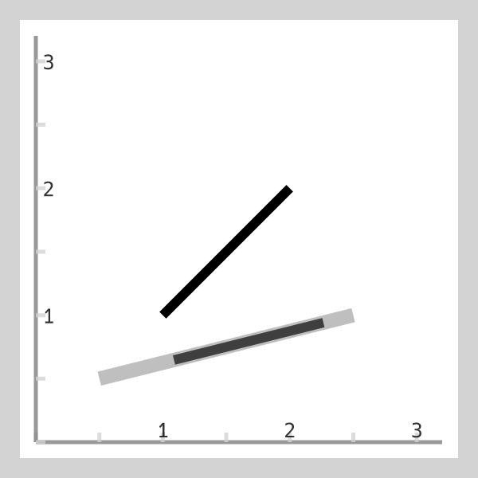

## Exploring the tool through help

`zsat` provides built-in documentation through subcommands. Instead of remembering every detail, you can query the tool directly.

To learn about the `vec2d` data format — input shapes, coordinate systems, and how vectors compose:

```bash
zsat draw vec2d --help
```

For a complete reference on style attributes — coordinate system (`xy`/`polar`), orientation (`fixed`/`origin`/`coord`), plot steps (`last`/`all`), and all line properties:

```bash
zsat draw vec2d style --help
```

To see how transformations are composed in `--outputs` — `anchor`, `rotate`, `scale`, `mirror`, `project`, `orthogonal` — and the syntax for angles and poins:

```bash
zsat draw vec2d output --help
```

For the syntax of points, both explicit `{(x,y)}` and by reference (`beg self`, `mid out0`, `25% self`):

```bash
zsat draw point --help
```

For the syntax of lines used in mirroring — general form, horizontal, vertical, and special cases like `y=x`:

```bash
zsat draw line --help
```

To browse available colors, here are some beginning with the letter **c**:
`coral`, `crimson`, `cyan`, `chocolate`, `chartreuse`, `cadetblue`, `cornflowerblue`, `cornsilk`.
You can see the full list wih:

```bash
zsat draw color --help
```
